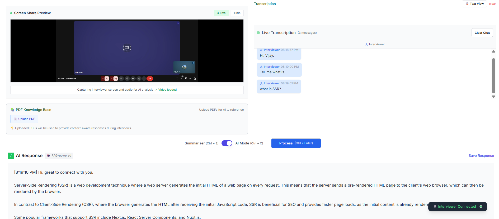
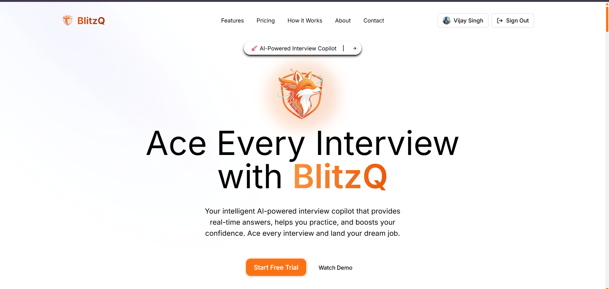
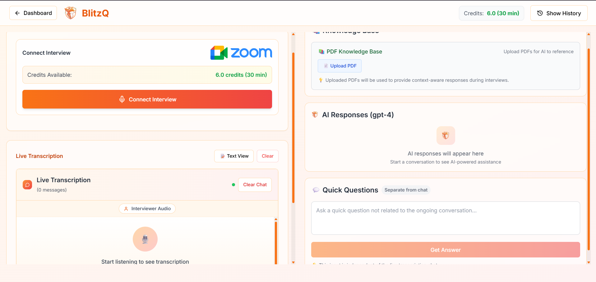
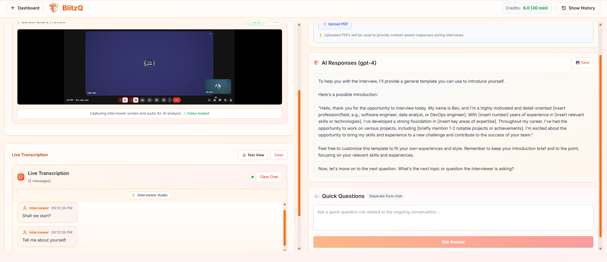
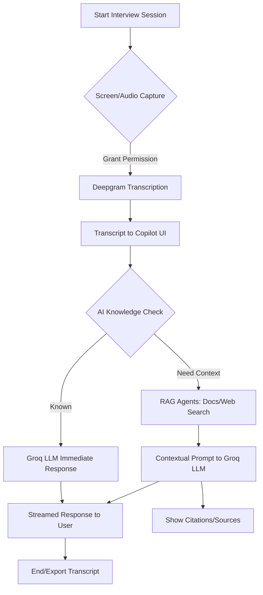

# AI Interview Copilot

<p align="center">
  
  
  
  
  
</p>

## What's new in this fork

This fork builds on [Vijay Singh's original project](https://github.com/Vijaysingh1621/AI-powererd-interview-Assistant). The original author acknowledgments and project background are retained below.

| Area | Improvements |
| --- | --- |
| Audio and Japanese support | Choose shared meeting-tab audio or microphone input. English, Japanese (`ja`), Mandarin Chinese, and German are available. |
| Language controls | **Transcription language**, **Translation language**, and **Answer language** are independent.|
| Inline translation | Each finalized transcript receives a smaller translation below the original. Choose a target language or **Off**; requests use the configured chat provider. |
| Document imports | Read PDF, Markdown (`.md` / `.markdown`), and TXT files, up to 10 MB. Text files do not need PDF conversion. |
| Chat models | Groq, DeepSeek, and configurable OpenAI-compatible chat APIs; model-specific options and credentials are isolated by provider. |
| Retrieval | Keep retrieved context when question extraction fails, prefer relevant original-language passages, and avoid invented personal details. |
| Reliability | Updated embeddings and model defaults, Unicode document IDs, empty-answer retries, accurate API errors, and a fix for duplicated streamed answers. |
| Private inputs | Real keys stay in ignored `.env.local`; personal PDFs and `.local-data/` backups are excluded from commits. |

See [document import details](docs/document-import.md) and [model provider configuration](docs/model-providers.md). The setup below applies to this fork. Uploads are manual; files are not watched for changes automatically.

---

## Overview

*AI Interview Copilot* is a next-generation, real-time AI-powered assistant designed to streamline and enhance the technical interview process. Built for interviewers, hiring managers, and technical recruiters, this tool leverages state-of-the-art speech-to-text, large language models (LLMs), and retrieval-augmented generation (RAG) to provide instant, context-aware support during live interviews. The Copilot transcribes interviewer audio, analyzes candidate responses, and delivers intelligent, actionable suggestions, summaries, and follow-up questions—all in a clean, professional, and minimal UI.

<p align="center">
  
  <br />
  <em>AI Interview Copilot - Real-time transcription and AI-powered assistance</em>
</p>

---

## Features

### 🎙 Real-Time Audio Transcription
- *Deepgram Integration:* Captures and transcribes interviewer/system audio in real time using advanced speech recognition.
- *Screen Sharing Preview:* Visual feedback for active screen/audio capture, with robust error handling and fallback logic.
- *Audio Sources:* Select meeting-tab playback or a microphone test; transcripts are displayed in the interview panel.

### 🤖 AI Reasoning & Response
- *Configurable Chat Models:* Use Groq (default), DeepSeek, or an OpenAI-compatible chat service for answers and question extraction.
- *Document Context:* When Gemini and Pinecone are configured, search uploaded documents before answering. Without a document configuration, the model can answer from general knowledge and supplied background.
- *Progressive Enhancement:* Users receive immediate AI responses, with additional sources and citations appended as soon as RAG completes, minimizing wait time.

### 📚 Retrieval-Augmented Generation (RAG)
- *Contextual Search:* When the LLM needs more information, RAG agents search internal documents, PDFs, and web sources to provide accurate, context-rich answers.
- *Citations & Sources:* All RAG-based responses include clear, structured citations for transparency and auditability.

### 📝 Minimal, Professional UI
- *Clean Design:* No gradients, cards, or unnecessary UI elements—just a focused, distraction-free workspace.
- *Chat-Style Transcription:* All interviewer speech is displayed in a chat interface, with clear timestamps and speaker labels.
- *Screen Sharing:* Prominent, resizable preview for screen/audio capture, with live status indicators.

### 🛡 Robustness & Security
- *Error Handling:* Graceful fallbacks for audio/video issues, API errors, and permission denials.
- *Environment Variables:* All API keys and sensitive configs are managed via .env files.
- *Explicit Audio Selection:* Meeting-tab mode captures tab playback; microphone mode captures the selected microphone after browser permission.

---


## 🚀 BlitzQ - Production SaaS Built on This Prototype

Building on this open-source prototype, I created *BlitzQ* - a comprehensive SaaS platform that takes interview preparation to the next level.

### *Ace Every Interview with BlitzQ*
Your intelligent AI-powered interview copilot that provides real-time answers, helps you practice, and boosts your confidence. Ace every interview and land your dream job.

<p align="center">
  
  <br />
  <em>BlitzQ - Production-ready AI interview assistance platform</em>
</p>

### *Real Interview Experience*
<p align="center">
  
  <br />
  <em>BlitzQ in action during a live technical interview - real-time AI suggestions and contextual help</em>
</p>

### *Practice and Examples*
<p align="center">
  
  <br />
  <em>BlitzQ's practice mode with curated interview questions and AI-generated example responses</em>
</p>

*BlitzQ Features:*
- 🎯 *Real-time AI Assistance*: Get instant, contextual answers during live interviews
- 📚 *Smart Knowledge Base*: Access curated technical questions and best practices
- 🎓 *Practice Mode*: Simulate interviews with AI feedback and improvement suggestions
- 📊 *Performance Analytics*: Track your progress and identify areas for improvement
- 🔐 *Enterprise Security*: SOC2 compliant with end-to-end encryption
- 🌍 *Multi-language Support*: Available in 15+ languages for global candidates

---


## System Flowchart




---


## Architecture

- *Frontend:* Next.js, React, Tailwind CSS
- *Audio/Video:* Web APIs for screen/audio capture, Deepgram SDK for transcription
- *AI/LLM:* Groq SDK for Llama 3 models, with intelligent routing between LLM and RAG
- *RAG:* Modular agents for document, PDF, and web search (Pinecone, Tavily, etc.)
- *Backend:* API routes for streaming LLM responses, RAG orchestration, and context management

---

## Getting Started

### 1. Clone the Repository
```bash
git clone https://github.com/helenshz/AI-powererd-interview-Assistant.git
cd AI-powererd-interview-Assistant
```
### 2. Install Dependencies
```bash
npm install
```

In Windows PowerShell, use `npm.cmd install` if execution policy blocks `npm.ps1`.
### 3. Configure Environment Variables
Copy the public template to a private local configuration, then fill in the keys you need:

```bash
cp .env.example .env.local
```

PowerShell equivalent: `Copy-Item .env.example .env.local`. `.env.example` intentionally has empty key fields. Never put real credentials in it or commit `.env.local`.

| Feature | Required configuration |
| --- | --- |
| Groq chat (default) | `LLM_PROVIDER=groq`, `GROQ_API_KEY`; optional `GROQ_MODEL` |
| DeepSeek chat | `LLM_PROVIDER=deepseek`, `DEEPSEEK_API_KEY`; optional `LLM_MODEL` (defaults to `deepseek-flash`) |
| Other compatible chat | `LLM_PROVIDER=openai-compatible`, `LLM_BASE_URL`, `LLM_API_KEY`, `LLM_MODEL` |
| Speech transcription | `DEEPGRAM_API_KEY` with permissions to access its project and issue temporary transcription keys |
| PDF/Markdown/TXT knowledge base | `GEMINI_API_KEY`, `PINECONE_API_KEY`, `PINECONE_INDEX_NAME=interview-docs` |
| Optional web search | `TAVILY_API_KEY` |

To create the 768-dimensional knowledge-base index, run `npm run setup-pinecone` (PowerShell: `npm.cmd run setup-pinecone`). Uploaded text uses `gemini-embedding-001` with 768 output dimensions.

`.env.local` means a local configuration file, not a local AI model. The application reads it on the server and sends requests to the selected cloud provider. The legacy `MODEL` field does not select the chat provider; use `LLM_PROVIDER` and the provider's model field. Restart the development server after changing configuration.

### 4. Run the App
```bash
npm run dev
```

PowerShell: `npm.cmd run dev`.
Visit [http://localhost:3000](http://localhost:3000) to use the Copilot.

---

## Usage

1. Select **Audio source** and **Transcription language**. Choose **Japanese** for Japanese speech recognition. Disconnect before changing transcription language, then reconnect. **Translation language** and **Answer language** can be set independently and changed while connected.
2. Click **Connect**. For a meeting, select its browser tab and enable tab audio. Your own microphone is captured only in microphone mode; speaking alone in a Meet room does not necessarily create tab playback audio.
3. Upload optional PDF, Markdown, or TXT notes through **Upload Document**. Existing indexed files remain stored in Pinecone across page refreshes, even if the current page's in-memory upload list is empty.
4. Each finalized transcript is automatically translated beneath its original text in a smaller font. Translation defaults to Chinese (Mandarin); select another language or **Off**. Changing the translation language updates displayed translations; identical source and target languages skip the extra request. Each translation uses the configured model API and may incur usage charges. A translation failure leaves the original visible with a retry control.
5. Select **Answer language**, then **AI Mode**, and click **Process**, or press **Ctrl+Enter**. Interview answers require this explicit action; automatic translation does not answer questions or change the transcript used for answers. **Summarizer** generates a summary instead.
6. Review the answer and citations. Matching-language source passages take priority over translating other versions. Use **Text View** to enter or edit a question without audio, and **Save Response** to keep an answer in local browser history.

---

## Advanced Capabilities

- *Intelligent LLM Routing:* The Copilot uses a knowledge-check prompt to decide if the LLM can answer directly. If not, it triggers RAG for deeper context.
- *Streaming Responses:* All AI and RAG responses are streamed for minimal latency.
- *Customizable Models:* Switch between Groq, DeepSeek, and compatible chat services using `.env.local`. Transcription and document embeddings have separate service configurations.
- *Extensible RAG Agents:* Add new document or web search agents by extending the RAG orchestrator.

---

## File Structure

- /app - Next.js app, API routes, and main pages
- /components - UI components (recorder, chat, PDF manager, etc.)
- /lib - Core logic (transcription manager, LLM/RAG clients, utils)
- /public - Static assets
- /scripts - Setup and utility scripts
- /docs - Technical and integration documentation

---

## Contributing

1. Fork the repo and create a feature branch.
2. Make your changes with clear, well-documented code.
3. Add/modify tests as needed.
4. Submit a pull request with a detailed description.

---

## Troubleshooting

- *Audio/Screen Not Captured:* Ensure browser permissions are granted for screen and audio.
- *API Errors:* Check `.env.local`, restart the server, and confirm the selected provider and model. HTTP 401 means authentication failed; HTTP 402 from DeepSeek means insufficient API balance; HTTP 429 means a rate or usage limit. A working model list does not guarantee enough balance for generation.
- *DeepSeek Connection Check:* Run `node scripts/check-model-connection.cjs` to test the provider selected in `.env.local`. It reads model availability and sends one short synthetic prompt, printing only diagnostic status. This uses the provider's API billing; no transcripts, notes, or credentials are printed.
- *Slow Responses:* RAG-based answers may take longer; LLM-only answers are near-instant.
- *UI Issues:* Clear browser cache or try a different browser.

---

## License

MIT License. See [LICENSE](./LICENSE) for details.

---

## Acknowledgments

- [Deepgram](https://deepgram.com) for real-time transcription
- [Groq](https://groq.com) for ultra-fast LLMs
- [Pinecone](https://pinecone.io) and [Tavily](https://tavily.com) for RAG/search
- [Next.js](https://nextjs.org), [React](https://react.dev), and [Tailwind CSS](https://tailwindcss.com) for the frontend

---

## Contact
Author: Vijay Singh
📧 Email: itisvijaysingh@gmail.com

🔗 LinkedIn: https://www.linkedin.com/in/vijay-singh-b25483288/

🔗 Repo: https://github.com/Vijaysingh1621/AI-powererd-interview-Assistant.git

For support, feature requests, or enterprise solutions, please contact the maintainers or open an issue on GitHub.
